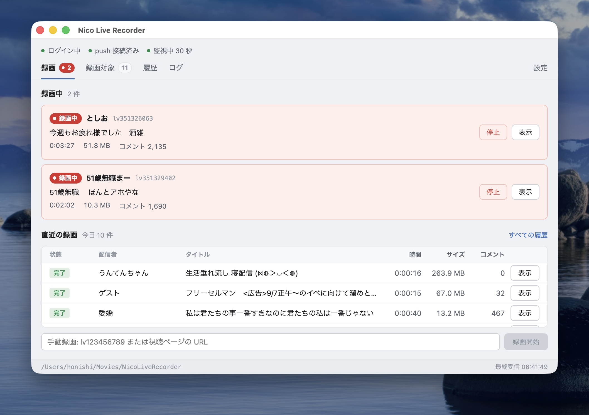

# NicoLiveRecorder

登録した配信者のニコニコ生放送を自動録画し、映像とコメントを保存する Windows / macOS 向けアプリです。
手動録画・タイムシフトの保存にも対応しています。

[公式サイト](https://honishi.github.io/nico-live-recorder/)

## インストール

[Releases](https://github.com/honishi/nico-live-recorder/releases/latest) からダウンロードしてください。

- **macOS (Apple Silicon)**: `.dmg` を開き、アプリを「アプリケーション」フォルダへ移動します。
- **Windows (x64)**: `.exe` を実行します。現在は未署名のため、「Windows によって PC が保護されました」と出た場合は「詳細情報」→「実行」を選んでください。

ニコニコのアカウントが必要です。FFmpeg は同梱済みです。

## 使い方

1. アプリからニコニコにログインします。
2. 録画したい配信者を **ニコニコ側でフォロー** します。
3. 「録画対象」に配信者のユーザー ID かユーザーページの URL を追加します。

放送が始まると自動で録画し、終了すると停止します。

- **手動録画**：「録画」タブで番組 ID (`lv123456789`) か番組 URL を指定します。フォローや録画対象への登録は不要です。
- **タイムシフト**：終了済みの番組を指定すると、ログイン中のアカウントで視聴できるタイムシフトを保存します。

## 知っておくこと

- **終了方法**：ウィンドウを閉じても検知と録画は続きます。終了はトレイ (macOS はメニューバー) のメニューから行います。
- **保存先**：macOS は `ムービー/NicoLiveRecorder`、Windows は `ビデオ\NicoLiveRecorder` が既定です。設定から変更できます。
- **保存ファイル**：映像・音声は `.ts`、コメントは `.comments.csv`、番組情報・録画結果は `.json`。録画ファイルは自動削除されず、履歴から削除しても残ります。詳細は [ファイル一覧](docs/files.md) を参照してください。
- **空き容量**：最高画質で録画するため、十分な空き容量を確保してください。容量の警告が出ても録画は止まりません。
- **手動停止**：停止した番組は、アプリの実行中は自動録画し直しません。再開は手動録画で行ってください。
- **更新**：新しい正式版は自動でダウンロードします。「再起動して更新」で適用してください。録画・タイムシフト取得中は適用できません。

## うまくいかないとき

- **録画が始まらない**：ログイン状態、フォロー、録画対象が有効か、画面上部が「監視中」かを確認してください。
- **タイムシフトを保存できない**：同じアカウントでニコニコの番組ページを開き、視聴できるか確認してください。
- **通知が出ない**：アプリの通知設定と OS の通知許可・集中モードを確認してください。
- **Windows の更新後に開かない**：アプリを手動で起動し、監視の再開を確認してください。

エラーの詳細は「ログ」タブで確認できます。自動更新に失敗した場合は、Releases から手動で更新してください。

## 開発・ライセンス

[開発者向けドキュメント](docs/development.md)

アプリ本体は [MIT ライセンス](LICENSE) です。同梱する [FFmpeg](https://ffmpeg.org/) / ffprobe は LGPL-2.1-or-later です (Copyright (c) 2000-2026 the FFmpeg developers)。

FFmpeg のライセンス本文、著作権表示、完全な対応ソースとビルド手順はアプリに同梱しています。設定の「情報」→「FFmpeg のライセンス・ソース」から参照できます。
